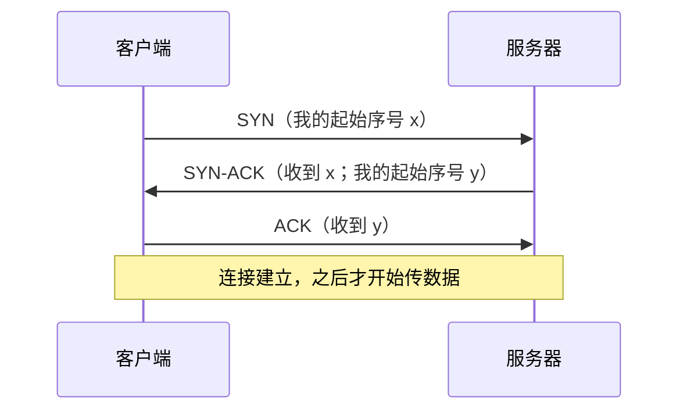
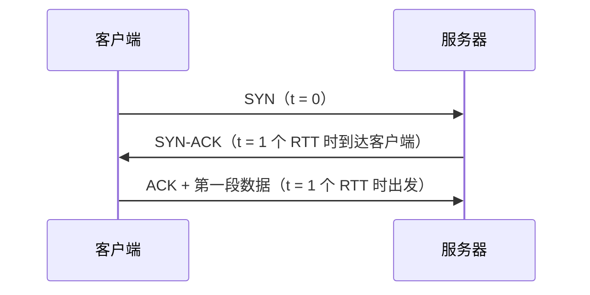

## T1：TCP 连接先完成三次握手才开始传数据

### 定位

这一节服务的目标是："网页打开慢的时候，网络里在发生什么"。路线是：IP 只管尽力送 packet → port 找到程序 → **TCP 先建立连接（本节）** → 连接里怎样保证不丢、不乱 → 丢包时为什么会卡一下。学完这一节，你能回答"一次请求在传数据之前，要先等一个来回"是从哪来的。

### 知识

**动机**：IP 送 packet 不保证到、不保证顺序（N1）。TCP 要在这上面做出"可靠的字节流"，就得给每个字节编号，让对方能发现缺了哪段、按顺序拼回去。这个编号叫 **sequence number**（序号）。问题是：双方从哪个号开始编？对方现在是否在线、能不能收？这两件事都要在传数据之前问清楚。

**主张**：建立连接要来回三条消息，叫**三次握手**：

1. 客户端发 **SYN**（synchronize，"我要建连接，我的起始序号是 x"）。
2. 服务器回 **SYN-ACK**（"收到你的 x 了，我的起始序号是 y"）。ACK（acknowledge，确认）表示"我收到了"。
3. 客户端回 **ACK**（"收到你的 y 了"）。

三条消息各自回答一个问题：第 1 条让服务器知道客户端能发；第 2 条让客户端知道服务器能收、也能发；第 3 条让服务器知道客户端能收。两条不够：只有第 1、2 条时，服务器不知道自己发出的 y 有没有被收到。

**联系**：和打电话先说"喂，听得到吗？""听得到，你呢？""我也听得到"类似；不同在于 TCP 同时交换了双方的起始序号。

### 例子一：三次握手中每条消息确认了什么

**题目**：浏览器连 `example.com:443`。服务器收到 SYN、回了 SYN-ACK 之后，它能确定客户端"能收到自己发的东西"吗？

**解答**：不能。

理由：服务器发出的 SYN-ACK 有没有到达客户端，只有客户端回 ACK 才能证明。按三条消息逐条看：

1. SYN 到达服务器 → 服务器知道：客户端能发，路是通的（客户端 → 服务器方向）。
2. 服务器发出 SYN-ACK → 这时服务器只是"发了"，还不知道到没到。
3. ACK 到达服务器 → 服务器才知道：SYN-ACK 到了客户端，客户端能收（服务器 → 客户端方向）。

**判断方法**：问"某一方确定了什么"时，只看它**收到了**哪些消息。自己发出去的消息，在收到对方的确认之前，不能证明任何事。

### 问题一

客户端发出 SYN，收到了服务器的 SYN-ACK，但它回的 ACK 在路上丢了。此时**服务器**能确定下面哪件事？

A. 客户端能收到服务器发的消息
B. 客户端能向服务器发消息
C. 连接已经建立，可以开始传数据
D. 客户端已经知道服务器的起始序号 y
E. 客户端发出的 ACK 丢了

### 问题二

另一个场景：服务器收到 SYN 后回了 SYN-ACK，但这条 SYN-ACK 丢了，客户端什么也没收到。此时**客户端**能确定下面哪件事？

A. 服务器能收到客户端的消息
B. 服务器的起始序号是 y
C. 自己发出的 SYN 到了服务器
D. 什么也不能确定
E. 服务器不在线

### 知识二：握手的时间代价

一个来回（packet 从一方到另一方、再有回复回来）所花的时间叫 **RTT**（round-trip time）。客户端发出 SYN 后，要等 SYN-ACK 回来，才知道服务器能收、也能发，所以客户端最早在**收到 SYN-ACK 的那一刻**发数据：它可以把第一段数据紧跟在第 3 条 ACK 后面一起发出。也就是说，握手让第一个数据字节至少晚出发一个 RTT。

### 例子二：建立连接的时间代价

**题目**：客户端到服务器的 RTT 是 80 ms。客户端在 t = 0 发出 SYN，没有丢包。客户端最早在什么时候发出第一段数据？

**解答**：t = 80 ms。

理由：按知识二的顺序走。SYN 在 t = 0 出发；SYN-ACK 回到客户端用掉一个 RTT，也就是 t = 80 ms；客户端在这一刻发出 ACK，第一段数据跟着一起出发。

**判断方法**：数客户端在发数据之前，必须**等回来**的消息有几条，每条要等一个 RTT。

### 问题三

客户端到服务器的 RTT 是 120 ms，客户端在 t = 0 发出 SYN，没有丢包。客户端最早在什么时候发出第一段数据？

A. t = 0
B. t = 60 ms
C. t = 120 ms
D. t = 180 ms
E. t = 240 ms

### 问题四

一个程序每次请求都新建一条 TCP 连接，连到 RTT 为 50 ms 的服务器，没有丢包。和"连接一直开着、直接发数据"相比，每次请求的数据最早晚出发多少？

A. 0 ms，握手和数据同时进行
B. 25 ms
C. 50 ms
D. 100 ms
E. 150 ms

### 回到全景

这一节的核心规律：一方能确定什么，只看它收到了哪些消息；三次握手正好让双方各自确认对方能收也能发。回到路线图：你现在能回答目标问题的前一半，"传数据之前要先等一个来回"就来自握手。下一环讲连接建立之后，TCP 怎样发现丢了哪段、怎样补发。

## 答案与解析

### 问题一

**B**。只看服务器收到了什么：它只收到过 SYN，所以只能确定"客户端能发"。
- A、D：要靠客户端的 ACK 才能证明，而 ACK 丢了。错在把"服务器发出了 SYN-ACK"当成"客户端收到了"。
- C：连接要等服务器收到 ACK 才算建立。
- E：这是从外面看到的事实。服务器并不知道 ACK 丢了，它只知道"还没收到"。

### 问题二

**D**。客户端什么也没收到，按判断方法，什么也不能确定。
- A、C：服务器确实收到了 SYN，但证明它的 SYN-ACK 丢了。错在把"我发出去了"当成"对方收到了"。
- B：y 写在丢掉的 SYN-ACK 里，客户端无从得知。
- E：没收到回复，也可能是回复丢了，不能推出服务器不在线。

### 问题三

**C**。客户端在发数据之前只需等回一条消息（SYN-ACK），等一个 RTT。
- A：忘了要先等 SYN-ACK。
- B：只算了单程。
- D、E：把第 3 条 ACK 也算成要等的消息；ACK 是客户端自己发出的，不用等回复，数据跟着它一起出发。

### 问题四

**C**。每次新建连接，数据都要等 SYN-ACK 回来才能出发，多等一个 RTT，即 50 ms。
- A：握手和数据不能同时进行，数据要等 SYN-ACK。
- B：只算了单程。
- D、E：把第 3 条 ACK 也算成要等的消息。
