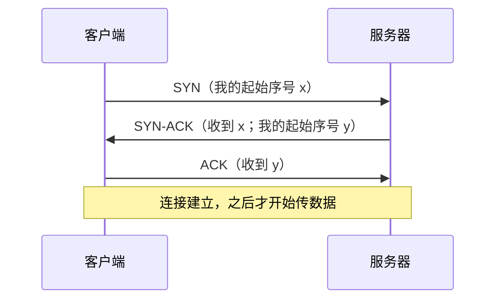

## T1：TCP 连接先完成三次握手才开始传数据

### 定位

这一节服务的目标是："网页打开慢的时候，网络里在发生什么"。路线是：IP 只管尽力送 packet → port 找到程序 → **TCP 先建立连接（本节）** → 连接里怎样保证不丢、不乱 → 丢包时为什么会卡一下。学完这一节，你能回答"一次请求在传数据之前，要先等一个来回"是从哪来的。

### 知识

**动机**：IP 送 packet 不保证到、不保证顺序（N1）。TCP 要在这上面做出"可靠的字节流"，就得给每个字节编号，让对方能发现缺了哪段、按顺序拼回去。这个编号叫 **sequence number**（序号）。问题是：双方从哪个号开始编？对方现在是否在线、能不能收？这两件事都要在传数据之前问清楚。

**主张**：建立连接要来回三条消息，叫**三次握手**：

1. 客户端发 **SYN**（synchronize，"我要建连接，我的起始序号是 x"）。
2. 服务器回 **SYN-ACK**（"收到你的 x 了，我的起始序号是 y"）。ACK（acknowledge，确认）表示"我收到了"。
3. 客户端回 **ACK**（"收到你的 y 了"）。

三条消息各自回答一个问题：第 1 条让服务器知道客户端能发；第 2 条让客户端知道服务器能收、也能发；第 3 条让服务器知道客户端能收。两条不够：只有第 1、2 条时，服务器不知道自己发出的 y 有没有被收到。

**联系**：和打电话先说"喂，听得到吗？""听得到，你呢？""我也听得到"类似；不同在于 TCP 同时交换了双方的起始序号。

读完有疑问就问，没问题就说继续。
